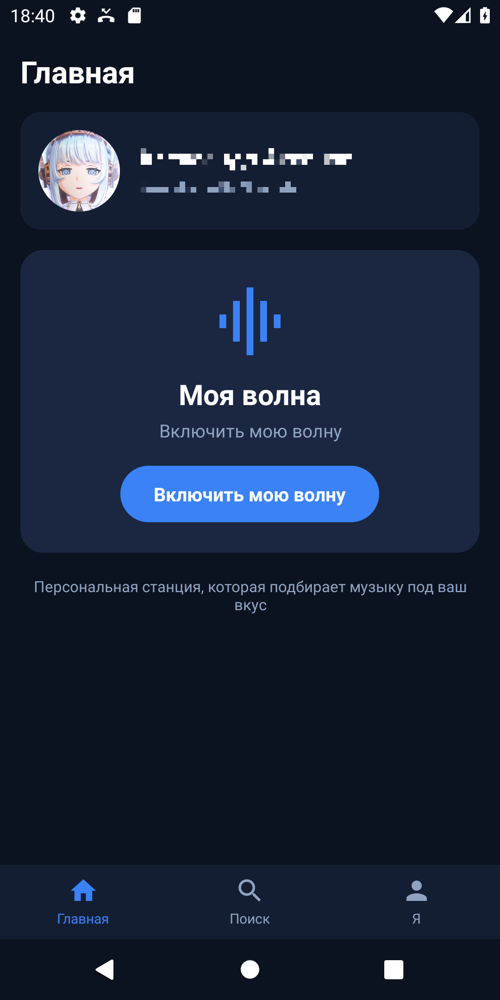
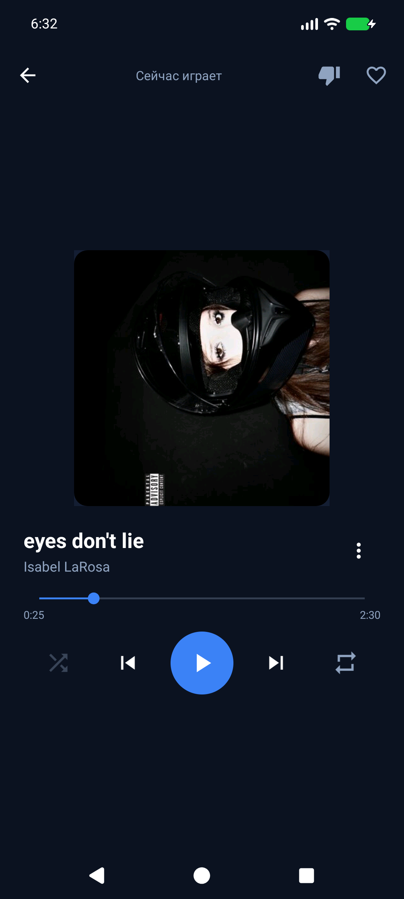
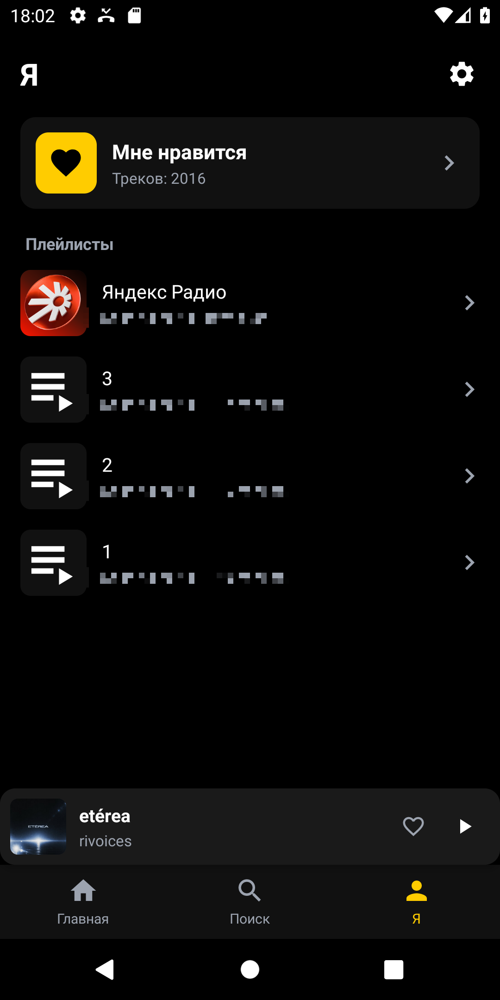
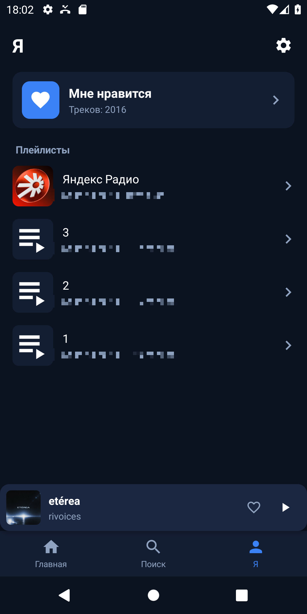
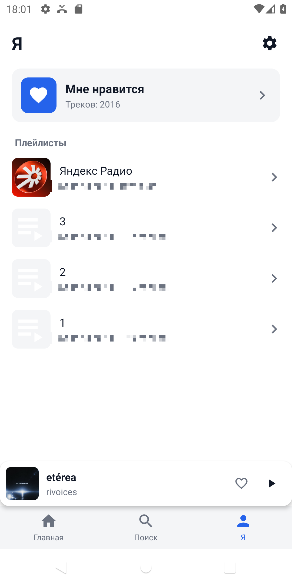

# YaMus

Неофициальный клиент Яндекс Музыки для Android 4+ (API 14–37). Написан на Kotlin с XML-разметкой и AppCompat — без Compose и Material Components.


> **Это вайбкод.** 

## Скриншоты

| Главная | Плеер |
|---|---|
|  |  |

| Чёрная тема | Тёмная тема | Светлая тема |
|---|---|---|
|  |  |  |

## Возможности

- Вход по OAuth-токену или по коду устройства.
- «Моя волна» на роторных сессиях: станция помнит прослушанное и не повторяет треки.
- «Моя волна по треку» и возврат к обычной волне.
- Поиск по трекам, артистам и альбомам.
- «Мне нравится», «Мне не нравится», плейлисты, страницы альбомов и артистов.
- Плеер с уведомлением и обложкой, экран блокировки, медиа-клавиши и Bluetooth-гарнитуры.
- Выбор качества звука, повтор трека и очереди.
- Контекстные меню: «Следующим», «В плейлист», «Моя волна по треку», «Поделиться ссылкой».
- Три темы: чёрная, тёмная синяя и светлая.
- Автоматическая очистка кэша при выходе из приложения.

## Требования

- Android Studio с JDK 17 (подойдёт встроенный JBR).
- Android SDK Platform 37 и Build-Tools 37.0.0.
- Gradle устанавливать не надо — wrapper уже в проекте.

## Сборка

Откройте папку `YaMus` в Android Studio и выполните в терминале:

```bat
gradlew.bat assembleDebug
```

На macOS/Linux — `./gradlew assembleDebug`. Готовый APK: `app/build/outputs/apk/debug/app-debug.apk`.

Если Android Studio не создала `local.properties`, укажите в нём путь к SDK:

```properties
sdk.dir=C\:\\Users\\<пользователь>\\AppData\\Local\\Android\\Sdk
```

## Release-сборка

Без ключа `assembleRelease` соберёт неподписанный APK. Для подписанного:

1. Создайте ключ (храните его вне репозитория):

   ```bash
   keytool -genkeypair -v -keystore yamus-release.jks -alias yamus -keyalg RSA -keysize 2048 -validity 10000
   ```

2. Скопируйте `keystore.properties.example` в `keystore.properties` и заполните значения.
3. Выполните `./gradlew assembleRelease`.

APK появится в `app/build/outputs/apk/release/`. Ключ и пароли в git не попадают. Ключ — «паспорт» приложения: им подписываются все версии, и при его потере установленное приложение нельзя будет обновить, только переустановить.

## Файлы проекта

| Файл | Назначение |
|---|---|
| `settings.gradle` | Список модулей проекта. |
| `build.gradle` | Версии плагинов и репозитории. |
| `app/build.gradle` | Настройки приложения: пакет, версии Android, зависимости, подпись. |
| `gradle.properties` | Флаги сборщика: AndroidX, память, предупреждения SDK. |
| `gradlew`, `gradlew.bat` | Скрипт сборки: сам скачивает нужную версию Gradle. |
| `gradle/wrapper/` | Настройки и jar для `gradlew` (Gradle 8.11.1). |
| `local.properties` | Путь к Android SDK. Локальный, в git не попадает. |
| `keystore.properties`, `*.jks` | Ключ подписи и пароли. Локальные, в git не попадают. |
| `app/src/main/AndroidManifest.xml` | Разрешения, экраны и службы приложения. |
| `app/src/main/java/` | Код на Kotlin. |
| `app/src/main/res/` | Разметка, картинки, строки и темы. |
| `app/build/` | Результаты сборки, включая APK. В git не попадает. |
| `docs/screenshots/` | Скриншоты для README. |
| `.gitignore`, `.gitattributes` | Исключения git и правила переводов строк. |

## Структура

```
app/src/main/java/ru/yamus/app/
├── core/api        Retrofit-клиент и эндпоинты
├── core/auth       OAuth и хранение токена
├── core/data       лайки, дизлайки, история волны
├── core/models     модели ответов API
├── core/net        TLS для Android 4+
├── core/player     MediaPlayer, сервис, кэш треков, волна
├── core/util       утилиты и очистка кэша
└── ui/             экраны, диалоги и адаптеры
```

## Технические детали

- OkHttp 3.12 и Retrofit 2.6 — старые версии специально, новые требуют Android 5+.
- Conscrypt добавляет TLS 1.2 на Android 4.x, иначе API не отвечает.
- Плеер — системный `MediaPlayer` в foreground-сервисе, уведомление и экран блокировки — через `MediaSessionCompat`.
- Обложки — Glide с дисковым кэшем на 64 МБ.

## Приватность

- Токен хранится в приватных `SharedPreferences` и передаётся только на `api.music.yandex.net`.
- Нет аналитики, рекламы и сторонних трекеров.
- Кэш очищается при выходе, если музыка не играет; после принудительного закрытия — при следующем запуске.
- История волны хранится локально (150 треков) и чистится при выходе из аккаунта.

## Ограничения

- API неофициальный и может измениться в любой момент.
- Интерфейс только на русском, отдельной вёрстки для планшетов нет.
- Постоянного офлайн-режима нет: кэш временный.
- Автотестов нет — проверялось вручную на Android 4.2.2 и на эмуляторе API 37.

## Дисклеймер

Проект не связан с Яндексом. «Яндекс Музыка» — товарный знак соответствующего правообладателя. Для работы нужен собственный аккаунт. Используйте на свой риск и не распространяйте скачанный контент.

## Лицензия

[MIT](LICENSE) © 2026 Sekorta

---

## English

YaMus is an unofficial Yandex Music client for Android 4+ (API 14–37), written in Kotlin with XML layouts and AppCompat. It supports OAuth login, an endless "My Wave" on rotor sessions, search, likes, playlists, artist and album pages, a notification player with media keys, three themes, audio quality selection, and automatic cache cleanup.

This is vibe code: the project was written in a dialogue with AI rather than by a development team. It is small enough to read and tweak.

Build with Android Studio and SDK Platform 37:

```bash
./gradlew assembleDebug
```

The APK is written to `app/build/outputs/apk/debug/app-debug.apk`. See the Russian sections above for release signing and privacy details.

Not affiliated with Yandex. Use your own account and at your own risk. Licensed under MIT.
