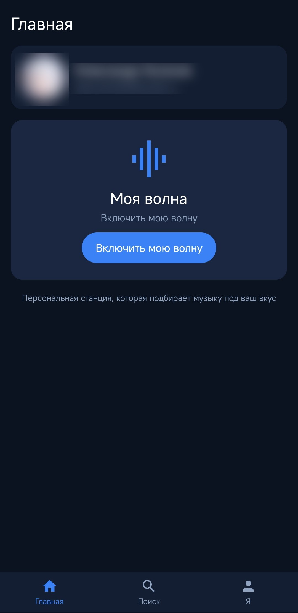
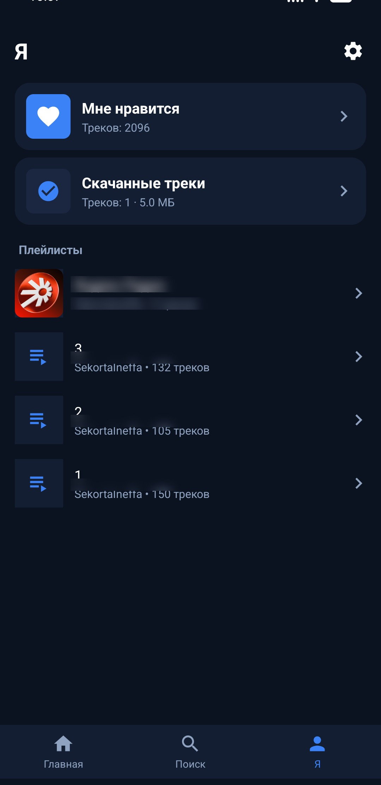
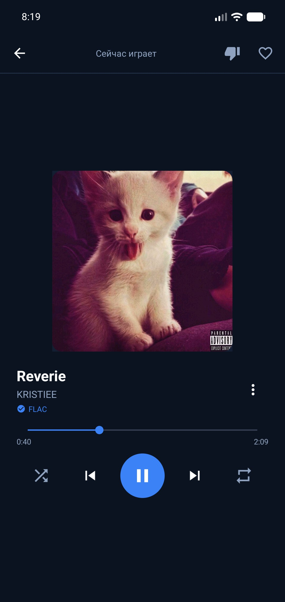
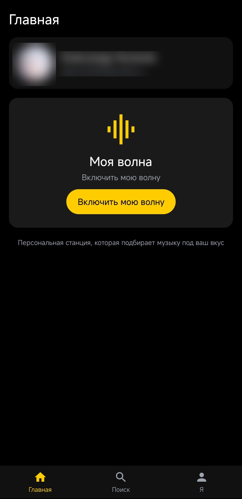
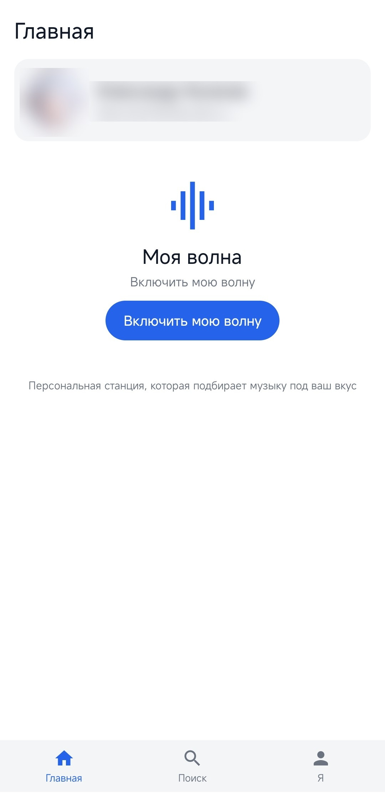
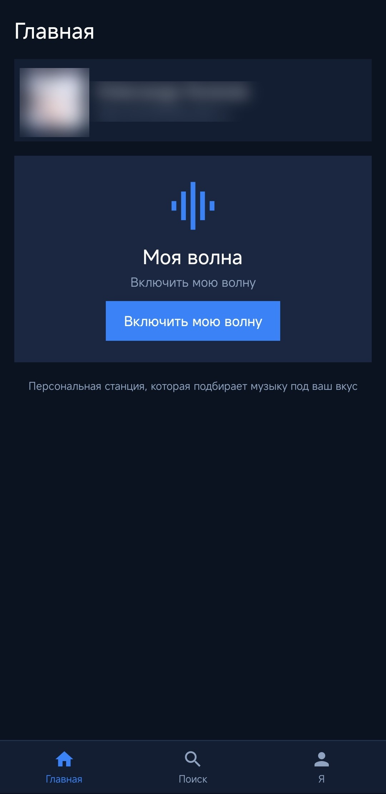
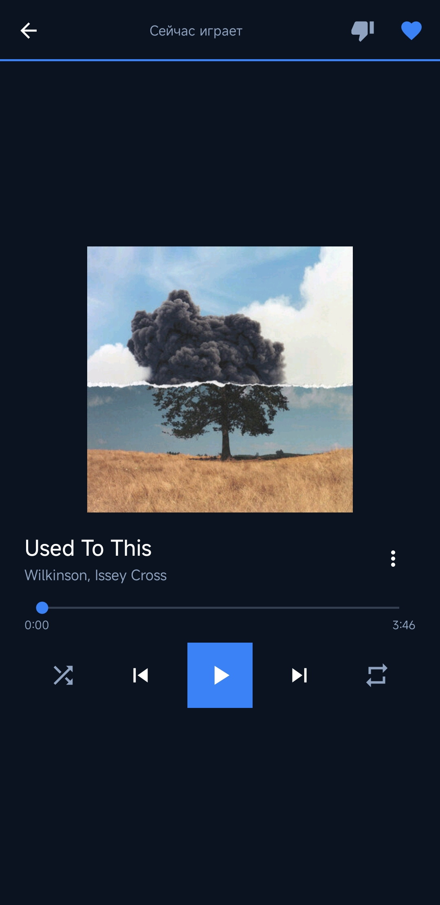
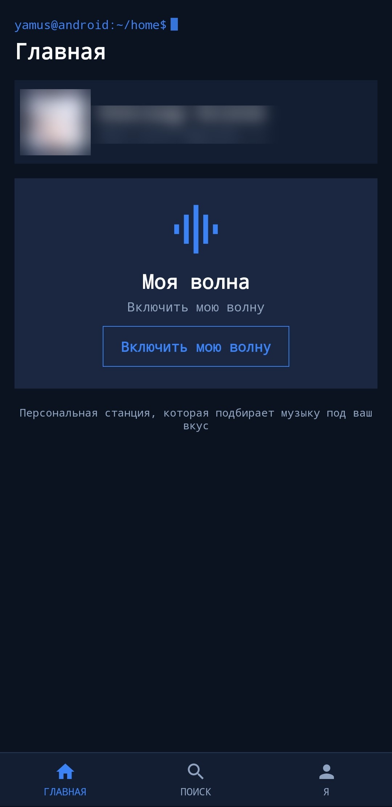
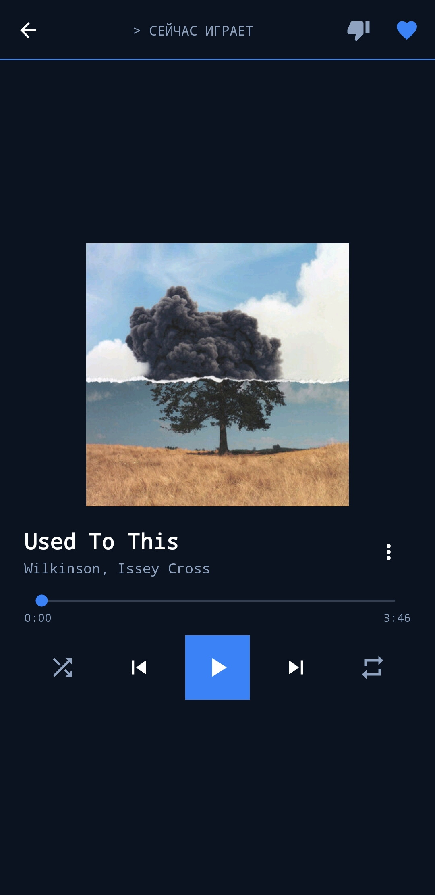

# YaMus

Неофициальный клиент Яндекс Музыки для Android 4+ (API 14–37). Написан на Kotlin с XML-разметкой и AppCompat — без Compose и Material Components.


> **Это вайбкод.** 

## Скриншоты

| Главная | Я | Плеер |
|---|---|---|
|  |  |  |

| Чёрная тема | Тёмная тема | Светлая тема |
|---|---|---|
|  |  |  |

| Стиль «Holo»: главная | Стиль «Holo»: плеер |
|---|---|
|  |  |

| Стиль «Терминал»: главная | Стиль «Терминал»: плеер |
|---|---|
|  |  |

## Возможности

- Вход по OAuth-токену или по коду устройства.
- «Моя волна» на роторных сессиях: станция помнит прослушанное и не повторяет треки.
- «Моя волна по треку» и возврат к обычной волне.
- Поиск по трекам, артистам и альбомам.
- «Мне нравится», «Мне не нравится», плейлисты, страницы альбомов и артистов.
- Плеер с уведомлением и обложкой, экран блокировки, медиа-клавиши и Bluetooth-гарнитуры.
- Выбор качества звука, повтор трека и очереди.
- Контекстные меню: «Следующим», «В плейлист», «Моя волна по треку», «Скачать», «Удалить скачанное», «Поделиться ссылкой».
- Офлайн-библиотека: скачанные треки лежат в `Music/YaMus Library` (на Android 10+; на старых версиях — в `YaMus Library` в корне накопителя), доступны без сети и переживают очистку кэша, выход из аккаунта, удаление и переустановку приложения. Встроенные обложки хранятся вне кэша и не пропадают после перезапуска; при удалении трека пустые папки артиста и альбома тоже убираются.
- Скачивание встроено в списки и плеер: значок и формат файла (`MP3`, `FLAC`, `M4A`, `AAC`, `OGG`) видны у каждой строки, а в теги записываются название, артист, альбом, год, номер трека, жанр, ссылка на трек и встроенная обложка.
- Lossless сохраняется как lossless: если Яндекс отдаёт `flac` или `flac-mp4` (FLAC в контейнере MP4), файл скачивается без перекодирования. `flac-mp4` пересобирается в обычный FLAC (`.flac`) с пометкой `FLAC` в списках, плеере и «Скачанных треках», поэтому файл открывается любым плеером. MP3 320 используется, только если сервер не отдал lossless-поток.
- Автозагрузка прослушанных треков (по умолчанию выключена) с режимами «только по Wi-Fi» и «только из „Мне нравится“».
- Раздел «Скачанные треки» на вкладке «Я» и вход в офлайн-библиотеку прямо с экрана входа («Слушать скачанное»). Присутствует сортировка: по артисту, названию, дате добавления, размеру и длительности.
- Ссылка на трек внутри альбома не только открывает альбом, но и подсвечивает нужную строку акцентной рамкой и прокручивает к ней список.
- Три цветовые темы: чёрная, тёмная синяя и светлая.
- Три стиля оформления, независимые от темы: «Material You» (скругления, карточки, воздух), «Holo» (прямые углы, плоские панели, плотные списки с разделителями) и «Терминал» (моноширинный шрифт, контурные элементы, приглашение командной строки с мигающим курсором).
- Настраиваемая автоматическая очистка кэша при выходе из приложения; скачанная библиотека при этом не затрагивается.

## Требования

- Android Studio с JDK 17 (подойдёт встроенный JBR).
- Android SDK Platform 37 и Build-Tools 37.0.0.
- Gradle wrapper уже в проекте.

## Сборка

Откройте папку `YaMus` в Android Studio и выполните в терминале:

```bat
gradlew.bat assembleDebug
```

На macOS/Linux — `./gradlew assembleDebug`. Готовый APK: `app/build/outputs/apk/debug/app-debug.apk`.

Если Android Studio не создала `local.properties`, укажите в нём путь к SDK:

```properties
sdk.dir=C\:\\Users\\<пользователь>\\AppData\\Local\\Android\\Sdk
```

## Release-сборка

Без ключа `assembleRelease` соберёт неподписанный APK. Для подписанного:

1. Создайте ключ:

   ```bash
   keytool -genkeypair -v -keystore yamus-release.jks -alias yamus -keyalg RSA -keysize 2048 -validity 10000
   ```

2. Скопируйте `keystore.properties.example` в `keystore.properties` и заполните значения.
3. Выполните `./gradlew assembleRelease`.


## Файлы проекта

| Файл | Назначение |
|---|---|
| `settings.gradle` | Список модулей проекта. |
| `build.gradle` | Версии плагинов и репозитории. |
| `app/build.gradle` | Настройки приложения: пакет, версии Android, зависимости, подпись. |
| `gradle.properties` | Флаги сборщика: AndroidX, память, предупреждения SDK. |
| `gradlew`, `gradlew.bat` | Скрипт сборки: сам скачивает нужную версию Gradle. |
| `gradle/wrapper/` | Настройки и jar для `gradlew` (Gradle 8.11.1). |
| `app/src/main/AndroidManifest.xml` | Разрешения, экраны и службы приложения. |
| `app/src/main/java/` | Код на Kotlin. |
| `app/src/main/res/` | Разметка, картинки, строки и темы. |
| `app/build/` | Результаты сборки, включая APK. В git не попадает. |
| `docs/screenshots/` | Скриншоты для README. |
| `.gitignore`, `.gitattributes` | Исключения git и правила переводов строк. |

## Структура

```
app/src/main/java/ru/yamus/app/
├── core/api        Retrofit-клиент и эндпоинты
├── core/auth       OAuth и хранение токена
├── core/data       лайки, дизлайки, история волны
├── core/download   офлайн-библиотека, теги и обложки
├── core/models     модели ответов API
├── core/net        TLS для Android 4+
├── core/player     MediaPlayer, сервис, кэш треков, волна
├── core/util       утилиты и очистка кэша
└── ui/             экраны, диалоги и адаптеры
```

## Технические детали

- OkHttp 3.12 и Retrofit 2.6 — старые версии специально, новые требуют Android 5+.
- Conscrypt добавляет TLS 1.2 на Android 4.x, иначе API не отвечает.
- Плеер — системный `MediaPlayer` в foreground-сервисе, уведомление и экран блокировки — через `MediaSessionCompat`.
- Обложки — Glide с дисковым кэшем на 64 МБ.
- Офлайн-библиотека пишется через `MediaStore` на Android 10+ и напрямую в файлы на старых версиях; после переустановки индекс восстанавливается по файлам и тегам. FLAC-in-MP4 пересобирается в нативный FLAC (`flac-mp4` → `.flac`) до записи тегов, поэтому формат остаётся `FLAC` и при пересканировании.
- Теги и встроенные обложки для MP3, FLAC и OGG записывает jaudiotagger, для MP4/M4A — собственный `Mp4Tagger`, который меняет только `moov` и не перепаковывает аудиоданные. Если тег записать не удалось, аудиофайл всё равно сохраняется.
- Мини-плеер сначала показывает сетевую обложку, а для скачанного трека подменяет её встроенной из файла, как только библиотека извлечёт её из тега.
- Цвета и геометрия разделены: палитра задаётся темой, а радиусы, отступы, разделители и плотность списков — стилем через атрибуты темы.

## Приватность

- Токен хранится в приватных `SharedPreferences` и передаётся только на `api.music.yandex.net`.
- Нет аналитики, рекламы и сторонних трекеров.
- Если включена автоочистка, кэш очищается при выходе, если музыка не играет; после принудительного закрытия — при следующем запуске. Автоочистку можно выключить в настройках.
- Скачанные треки лежат отдельно от кэша, в общей папке `Music/YaMus Library`, и доступны другим плеерам. Очистка кэша, выход из аккаунта, удаление и переустановка приложения их не удаляют.
- История волны хранится локально (150 треков) и чистится при выходе из аккаунта.

## Ограничения

- API неофициальный и может измениться в любой момент.
- Интерфейс только на русском, отдельной вёрстки для планшетов нет.
- Формат скачанного файла соответствует потоку, который отдаёт API для выбранного качества: переключение качества не перекодирует уже скачанное.
- На Android 4–9 (`API < 29`) запрашивается только `flac`, без `flac-mp4`: FLAC в MP4-контейнере может не проигрываться системным `MediaPlayer`, поэтому при недоступности обычного FLAC остаётся MP3 320.
- На Android 13+ для поиска скачанных треков после переустановки нужно разрешение на доступ к аудио; на Android 10+ файлы лежат в `Music/YaMus Library`.
- Скачивать можно только треки, доступные аккаунту для прослушивания.

## Дисклеймер

Проект не связан с Яндексом. «Яндекс Музыка» — товарный знак соответствующего правообладателя. Для работы нужен собственный аккаунт. Используйте на свой риск и не распространяйте скачанный контент.

## Лицензия

[MIT](LICENSE) © 2026 Sekorta

---

## English

YaMus is an unofficial Yandex Music client for Android 4+ (API 14–37), written in Kotlin with XML layouts and AppCompat. It supports OAuth login, an endless "My Wave" on rotor sessions, search, likes, playlists, artist and album pages, a notification player with media keys, three color themes with three independent presentation styles (Material You, Holo and terminal), audio quality selection, and automatic cache cleanup.

It also has a real offline library. Downloaded tracks are written to `Music/YaMus Library` (Android 10+; the storage root on older versions) as ordinary audio files with full tags and embedded covers, so they survive cache clearing, logout, uninstall and reinstall. Lossless streams from Yandex (`flac` and `flac-mp4`) are saved as-is: FLAC-in-MP4 is demuxed into a native `.flac` file, so it stays lossless and plays in any player, and is labelled `FLAC` in lists, the player and the downloads screen. Downloads and their audio format are shown in track lists and the player; auto-download can be limited to Wi-Fi and to tracks started from "Liked tracks", and the Me tab has a "Downloaded tracks" section with its own mini player, bottom navigation and sorting (artist, title, newest, size, duration). Embedded covers are kept outside the cache, so they survive restarts and cache cleanup, and deleting a track also removes now-empty artist and album folders. Playback can start offline straight from the login screen. The settings page controls auto-download, Wi-Fi-only mode and cache cleanup, and album links open the album with the linked track outlined and scrolled into view.

This is vibe code: the project was written in a dialogue with AI rather than by a development team. It is small enough to read and tweak.

Build with Android Studio and SDK Platform 37:

```bash
./gradlew assembleDebug
```

The APK is written to `app/build/outputs/apk/debug/app-debug.apk`. See the Russian sections above for release signing and privacy details.

Not affiliated with Yandex. Use your own account and at your own risk. Licensed under MIT.
